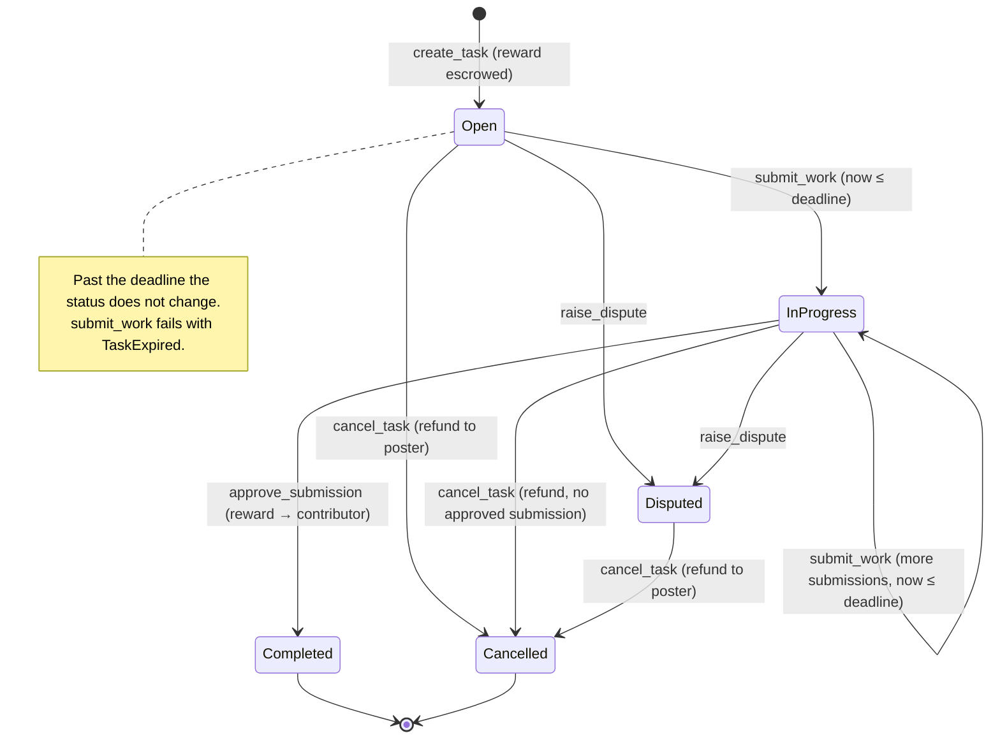

# TaskBounty: Task Expiry and Refund Lifecycle

How deadlines, expiry and escrow refunds work in the TaskBounty contract (issue #1250). This
describes the current implementation in `src/task.rs`, `src/submission.rs`, `src/dispute.rs`
and `src/types.rs`. Where the behaviour is easy to misread, it is called out explicitly.

---

## 1. Summary

| Question | Answer (current contract) |
| --- | --- |
| Is the reward escrowed? | Yes. `create_task` transfers `reward` from the poster to the contract. |
| What does the deadline do? | It blocks **new submissions** once `ledger timestamp > deadline` (`TaskExpired`). |
| Does a task expire by itself? | **No.** There is no expiry entrypoint, and no status change happens at the deadline. |
| Who can trigger a refund? | Only the **poster**, via `cancel_task`. |
| When can the poster refund? | Any time, before or after the deadline, unless the task is `Completed` or `Cancelled`, or a submission has been approved. |
| Where does the refund go? | The full `reward` goes back to the poster, in the task's `token`. |
| Can a contributor reclaim anything? | No. Contributors are only ever paid through `approve_submission`. |

---

## 2. Deadline rules at creation

`create_task(poster, title, description, token, reward, deadline, max_submissions)` checks:

| Check | Error |
| --- | --- |
| `reward >= 1_000_000` (0.1 units at 7 decimals, `MIN_REWARD`) | `InsufficientReward` (7) |
| `deadline > now` | `InvalidDeadline` (8) |
| `deadline <= now + 31_536_000` (365 days, `MAX_DEADLINE`) | `InvalidDeadline` (8) |
| `max_submissions > 0` | `InvalidMaxSubmissions` (9) |

`deadline` is an absolute Unix timestamp in seconds, compared with `env.ledger().timestamp()`.

---

## 3. When a task counts as "expired"

A task is past its deadline when `ledger timestamp > task.deadline`. The comparison is strict: a
submission landing exactly at `deadline` is still accepted.

Being past the deadline only affects `submit_work`:

| Entrypoint | Before deadline | After deadline |
| --- | --- | --- |
| `submit_work` | Allowed (if status is `Open`/`InProgress`, the contributor hasn't submitted, and `submission_count < max_submissions`) | **Rejected with `TaskExpired` (4)** |
| `approve_submission` | Allowed for `Pending` submissions | **Still allowed.** Work submitted on time can be approved late. |
| `reject_submission` | Allowed | Still allowed |
| `raise_dispute` | Allowed for `Pending`/`Rejected` submissions | Still allowed |
| `cancel_task` (refund) | Allowed (see §4) | Allowed (see §4) |

The stored `status` is **not** updated at the deadline. An `Open` task stays `Open` after its
deadline; it simply cannot receive new submissions. Off-chain consumers should treat
`status ∈ {Open, InProgress} && now > deadline` as "expired" for display purposes.

---

## 4. Refund eligibility (`cancel_task`)

`cancel_task(task_id, poster)` requires the poster's authorization and refunds the **entire**
escrowed `reward` to the poster.

| Condition | Result |
| --- | --- |
| Task does not exist | `TaskNotFound` (1) |
| Caller is not the poster | `Unauthorized` (3) |
| Status is `Completed` | `InvalidTaskStatus` (5): the reward has already been paid |
| Status is `Cancelled` | `InvalidTaskStatus` (5): already refunded, so no double refund |
| Any submission for the task is `Approved` | `InvalidTaskStatus` (5) |
| Status `Open`, `InProgress` or `Disputed`, with no approved submission | **Refunded**. Status becomes `Cancelled` and a `("task", "cancel")` event is emitted. |

Limitations to be aware of:

- **No partial refunds.** It is all of `reward` or nothing.
- **No automatic refund at the deadline.** An expired task's escrow stays in the contract until
  the poster calls `cancel_task`.
- **Pending work does not block cancellation.** The poster can cancel while submissions are still
  `Pending`, including after the deadline. Those contributors receive nothing.
- **Disputes do not block cancellation.** `raise_dispute` moves the task to `Disputed`, and the
  contract currently has no dispute-resolution entrypoint, so `cancel_task` is the only way out of
  `Disputed`. While a dispute is active for a submission, that submission cannot be approved.

---

## 5. State transitions



Submission states: `Pending → Approved` (`approve_submission`, which pays out and completes the
task) or `Pending → Rejected` (`reject_submission`). Only `Pending` or `Rejected` submissions can
be disputed.

---

## 6. Examples

The examples use the `stellar` CLI. Replace the IDs and keys with your own.

**Successful refund after the deadline, with no approved work**

```bash
# Task 7: deadline has passed, one Pending submission, nothing approved.
stellar contract invoke --id $TASK_BOUNTY --source poster -- \
  cancel_task --task_id 7 --poster $POSTER_ADDRESS
# → status = Cancelled, reward transferred back to the poster, event ("task", "cancel") with (7, poster)
```

**Late submission is rejected**

```bash
stellar contract invoke --id $TASK_BOUNTY --source contributor -- \
  submit_work --task_id 7 --contributor $CONTRIBUTOR --work_url "ipfs://…" --description "done"
# → Error(Contract, #4)  TaskExpired: ledger timestamp > deadline
```

**Refund refused because work was approved**

```bash
# Task 9: the poster approved submission 3 (task is Completed, contributor paid).
stellar contract invoke --id $TASK_BOUNTY --source poster -- \
  cancel_task --task_id 9 --poster $POSTER_ADDRESS
# → Error(Contract, #5)  InvalidTaskStatus
```

**Refund refused for someone other than the poster**

```bash
stellar contract invoke --id $TASK_BOUNTY --source someone_else -- \
  cancel_task --task_id 7 --poster $SOMEONE_ELSE
# → Error(Contract, #3)  Unauthorized
```

**Approving on-time work after the deadline (allowed)**

```bash
# Submission 12 was made before the deadline; approving it later still pays out.
stellar contract invoke --id $TASK_BOUNTY --source poster -- \
  approve_submission --task_id 7 --submission_id 12 --poster $POSTER_ADDRESS
# → submission Approved, task Completed, reward → contributor
```

---

## 7. Notes for integrators

- Show "expired" in UIs from `now > deadline` while `status` is still `Open`/`InProgress`. The
  contract does not store this.
- Remind posters that expired escrow only comes back when they call `cancel_task`.
- Watch `("task", "cancel")` events for refunds and `("sub", "approved")` events for payouts; see
  `CONTRACT_EVENT_REFERENCE.md` (TaskBounty section).
- The full error list is in `docs/CONTRACT_ERROR_TABLE.md` (TaskBounty section).
