# NotifyChain Database Schema and Relationships

> **Audience:** Backend contributors, operators, and data consumers.
>
> **Schema authority:** `listener/src/database/schema.sql` is the fresh-install
> SQLite schema. Changes also belong in the appropriate migration under
> `listener/src/migrations/`; auxiliary schemas live in the files linked below.

## 1. Scope

The Listener uses a single embedded SQLite database by default at
`DATABASE_PATH` (`./data/notifications.db`). Foreign-key enforcement is enabled
at connection time and migrations are transactional.

The PostgreSQL claims in older architecture notes describe a future migration
path, not a current runtime implementation. This document describes the schema
that exists in the current SQLite codebase.

## 2. Entity Relationship Diagram

```mermaid
erDiagram
  scheduled_notifications ||--o{ notification_execution_log : "execution attempts"
  scheduled_notifications ||--o| dead_letter_queue : "terminal failure"
  scheduled_notifications ||--o{ idempotency_keys : "response to request"
  scheduled_notifications ||--o{ schedule_audit_log : "lifecycle"
  notification_templates ||--o{ notification_template_audit_log : "modification history"
  channel_templates ||--o{ template_usage_log : "render history"
  scheduled_notifications ||--o{ notification_archive : "archived snapshot"
  processed_events
  polling_cursors
  delivery_receipts
  rate_limit_events
  backpressure_events
  notification_metrics_snapshots
  security_audit_log
  event_provenance
  migrations

  scheduled_notifications {
    INTEGER id PK
    TEXT payload
    TEXT notification_type
    TEXT target_recipient
    DATETIME execute_at
    DATETIME expires_at
    TEXT status
    INTEGER retry_count
    TEXT deduplication_key
  }
  notification_execution_log {
    INTEGER id PK
    INTEGER scheduled_notification_id FK
    INTEGER execution_attempt
    TEXT status
  }
  dead_letter_queue {
    INTEGER id PK
    INTEGER scheduled_notification_id FK
    TEXT failure_reason
  }
  idempotency_keys {
    INTEGER id PK
    TEXT idempotency_key UK
    INTEGER response_notification_id FK
  }
  schedule_audit_log {
    INTEGER id PK
    INTEGER scheduled_notification_id FK
    TEXT action
  }
  notification_templates {
    TEXT id PK
    TEXT name
    TEXT type
    TEXT body
  }
  notification_template_audit_log {
    INTEGER id PK
    TEXT template_id FK
    TEXT previous_snapshot
    TEXT new_snapshot
  }
  channel_templates {
    INTEGER id PK
    TEXT unique_key UK
    TEXT channel_type
  }
  template_usage_log {
    INTEGER id PK
    INTEGER template_id FK
  }
  notification_archive {
    INTEGER id PK
    INTEGER original_id
    TEXT status
  }
```

`delivery_receipts.notification_id` is a logical reference to
`scheduled_notifications.id`; the current table has no foreign-key declaration.
Likewise, `notification_archive.original_id` intentionally has no foreign key
because it is a snapshot that outlives deletion of the active row.

## 3. Core Delivery and Scheduling Entities

### `scheduled_notifications`

One durable work item for Discord, email, webhook, or SMS delivery.

| Field | Constraint / meaning |
|---|---|
| `id` | `INTEGER PRIMARY KEY AUTOINCREMENT` |
| `payload` | `TEXT NOT NULL`; JSON notification payload, potentially compressed |
| `payload_hash` | Integrity/hash metadata |
| `notification_type` | `NOT NULL`; one of `discord`, `email`, `webhook`, `sms` |
| `target_recipient` | `NOT NULL`; channel-specific identifier or destination |
| `execute_at` | `NOT NULL`; due time |
| `expires_at` | Optional delivery deadline |
| `created_at`, `updated_at` | Timestamps; update trigger maintains `updated_at` |
| `version` | Positive integer, default `1` |
| `recovery_state` | `NULL` or `AWAITING_INTERVENTION` |
| `status` | `PENDING`, `PROCESSING`, `COMPLETED`, `FAILED`, `CANCELLED`, `EXPIRED`, or `DEAD_LETTERED` |
| `retry_count`, `max_retries` | Non-negative retry counters and limit |
| `processing_started_at`, `processing_completed_at` | Processing lifecycle timestamps |
| `processor_id`, `lock_expires_at` | Distributed worker claim metadata |
| `last_error`, `error_details` | Error summary and JSON context |
| `event_id`, `contract_address` | Optional source-event and contract references |
| `priority` | Integer from `1` through `10`, default `5` |
| `metadata` | Optional JSON text |
| `next_retry_at` | Explicit retry time |
| `deduplication_key` | Optional caller key; unique for non-NULL values |
| `recurrence_rule`, `occurrence_count`, `last_run_at` | Recurring notification state |

### `notification_execution_log`

Historical delivery attempts for an active notification.

- `scheduled_notification_id` references `scheduled_notifications(id)` with
  `ON DELETE CASCADE`.
- `execution_attempt` must be greater than zero.
- `status` is `SUCCESS`, `FAILED`, `RETRY`, or `DEAD_LETTERED`.
- `duration_ms` is non-negative when present.
- `response_data` and `error_message` hold provider/error data.

Deleting or pruning the parent notification also deletes its attempt history.
The archive table does not reproduce attempt records.

### `dead_letter_queue`

Stores notifications that cannot be delivered successfully.

- `scheduled_notification_id` is `NOT NULL`, `UNIQUE`, and cascades from
  `scheduled_notifications`.
- `notification_type`, `target_recipient`, `payload`, and `failure_reason` are
  required.
- `retry_count` must be non-negative.
- One dead-letter row exists for at most one active scheduled notification.

### `delivery_receipts`

Provider delivery state and one-way delivery attempt evidence.

- `notification_id` is a logical scheduled-notification identifier.
- `status` is `delivered`, `failed`, `rejected`, or `pending`.
- `attempt_count` must be positive.
- `provider_message_id`, `provider_response`, `error_code`, and
  `error_message` capture provider-specific details.
- The table has no foreign key in the current schema.

### `notification_archive`

Terminal notification snapshots retained after active rows are pruned.

- `original_id` records the former scheduled-notification primary key.
- Terminal `status` values are `COMPLETED`, `FAILED`, `CANCELLED`, `EXPIRED`,
  or `DEAD_LETTERED` in the current core schema.
- It does not own or reference the original row and does not retain execution-log
  children. It is an archival copy, not a parent/child relationship.

## 4. Event Ingestion and Idempotency Entities

### `processed_events`

Persistent event deduplication and reorg-processing state.

- `event_id`, `contract_address`, `fingerprint`, `ledger_number`, and
  `event_type` identify and classify an event.
- `fingerprint` is `UNIQUE`; it is intended to combine contract and event identity.
- `ledger_number`, reorg counters, and booleans use non-negative or 0/1 checks.
- `status` is `PROCESSED`, `SKIPPED`, or `ERROR`.
- `notification_sent` records whether downstream notification work was initiated.

### `polling_cursors`

Tracks one polling cursor per `contract_address`:

- `contract_address` is `UNIQUE`.
- `cursor` and `ledger_number` are required.
- Reorg fields track detection count and latest reorg state.

### `idempotency_keys`

Prevents duplicate notification creation for the same request key.

- `idempotency_key` is globally unique.
- `request_hash` makes payload reuse detectable.
- `response_notification_id` is a foreign key to `scheduled_notifications(id)`
  with `ON DELETE CASCADE`.
- `response_data` retains the response returned to the original/repeated request.
- `expires_at` controls key lifetime; status is `PROCESSED` or `EXPIRED`.

### `event_provenance`

Created lazily by `EventProvenanceStore` rather than by `schema.sql`.

- `(event_id, contract)` is unique.
- `network`, `contract`, `ledger`, and `ingestion_path` are required.
- `ledger` is non-negative.
- `ingestion_path` is `rpc-poll`, `backfill`, or `replay`.

## 5. Audit and Operational Entities

### `schedule_audit_log`

Immutable lifecycle audit trail for scheduled notifications.

- Foreign key to `scheduled_notifications(id)` with `ON DELETE RESTRICT`.
- Actions are `CREATED`, `MODIFIED`, `CANCELLED`, or `EXECUTED`.
- `details` is expected to contain identifiers/context, not the full payload.
- Update and delete triggers reject mutation.

### `notification_templates`

Audited reusable notification records, identified by text `id`.

- `name`, `type`, and `body` are required.
- `subject`, `variables`, and `metadata` are optional JSON/text fields.
- `update_notification_templates_timestamp` maintains `updated_at`.

### `notification_template_audit_log`

Immutable template snapshots.

- `template_id` references `notification_templates(id)` with `ON DELETE RESTRICT`.
- `action` is currently `UPDATE`.
- Update and delete triggers abort mutations.

### `channel_templates`

Channel-specific templates in `template-schema.sql`, separate from
`notification_templates`.

- Integer primary key and globally unique `unique_key`.
- Fields include channel type, subject/body templates, variables,
  defaults, active state, version, and created/updated actor metadata.
- `template_usage_log.template_id` references this table with `ON DELETE CASCADE`.

### `template_usage_log`

Render/dispatch analytics for `channel_templates`.

- Stores recipient, result status, rendering context, and error text.
- `rendered_at` is recorded automatically.

### `rate_limit_events`

Audit records for request throttling.

- `client_id` and `client_type` (`IP` or `API_KEY`) identify the source.
- `endpoint`, `method`, `timestamp`, `limit_threshold`, and `window_ms` describe
  the enforced limit.

### `backpressure_events`

Queue saturation activation/deactivation history.

- `event_type` is `ACTIVATED` or `DEACTIVATED`.
- Queue size and target throughput must be non-negative.
- `duration_ms` is non-negative when a deactivation duration is recorded.

### `notification_metrics_snapshots`

Persisted delivery metric snapshots.

- `captured_at` is the snapshot time.
- `window_start` and `window_end` define the measurement interval.
- `window_start <= window_end` and `total_recorded >= 0` are enforced.

### `security_audit_log`

Security-sensitive authentication, permission, and administration records.

- The table is defined in `listener/src/migrations/003-add-security-audit-log.sql`.
- Fields include `action`, `actor`, `timestamp`, `source_ip`, `request_id`,
  `correlation_id`, `outcome`, and JSON/text `details`.
- It has no foreign-key relationships.

### `migrations`

Migration ledger managed by `MigrationRunner`.

- `id` is the primary key.
- `name` and `applied_at` identify the migration and application time.
- Migration entries are inserted and deleted together with migration rollback
  transactions.

## 6. Important Indexes

| Area | Index(es) | Query purpose |
|---|---|---|
| Scheduler claims | `idx_scheduled_notifications_claim`, `idx_scheduled_notifications_status_execute_at`, `idx_scheduled_notifications_next_retry_at`, `idx_scheduled_notifications_processor_lock` | Find, lock, and retry due pending work |
| Scheduler search | `idx_scheduled_notifications_status_created`, `idx_scheduled_notifications_type_status`, `idx_scheduled_notifications_type_lower_created`, `idx_scheduled_notifications_contract`, `idx_scheduled_notifications_target` | Status/type/contract/recipient searches and sorting |
| Notification cleanup | `idx_scheduled_notifications_archivable`, `idx_scheduled_notifications_created_at` | Batch terminal-row archival and retention |
| Execution history | `idx_execution_log_notification_id`, `idx_execution_log_execution_time`, `idx_execution_log_status_execution_time`, `idx_execution_log_notification_attempt` | Join attempts and summarize success/failure |
| Dead letters | `idx_dead_letter_queue_created_at`, `idx_dead_letter_queue_notification_type` | Cleanup and operator filtering |
| Idempotency | unique `idx_scheduled_notifications_dedup_key`, and `idempotency_keys(idempotency_key / expires_at / created_at)` | Reject duplicate work and purge expired requests |
| Delivery receipts | `(notification_id, attempt_count, id)`, `(status, created_at)` | Find latest/provider attempts and filter delivery state |
| Event deduplication | `fingerprint`, `(contract_address, event_id)`, `(ledger_number, contract_address)`, status/time and tx-hash indexes | Deduplication, reorg processing, and reconciliation |
| Cursors | contract-address and updated-time indexes | One-row cursor lookup and stale-cursor cleanup |
| Audits | notification, timestamp, and action indexes on schedule/template/security audits | Lifecycle, compliance, and actor/action queries |
| Templates | type/key/channel/active and usage timestamp indexes | Template lookup and usage history |
| Operations | rate-limit client/time, backpressure type/time, metrics capture-time indexes | Telemetry and saturation analysis |

See [DATABASE_QUERY_PERFORMANCE.md](DATABASE_QUERY_PERFORMANCE.md) for query
plans and measured indexing results.

## 7. SQLite-Specific Behavior

- **Foreign keys:** `PRAGMA foreign_keys = ON` is set after opening the
  connection. The migration runner also verifies it before applying migrations.
- **Transactions:** Bootstrap DDL and individual migrations use transactions.
  Migrations roll back on SQL errors.
- **Busy timeout:** writes wait up to 5 seconds for competing SQLite connections.
- **Write concurrency:** SQLite has a single-writer model. The listener should
  normally run as one database owner per database file.
- **DATETIME/JSON:** SQLite stores DATETIME values as text and JSON as text;
  application code parses and serializes JSON consistently.
- **Booleans:** stored as integer `0`/`1` with explicit `CHECK` constraints.
- **Partial and expression indexes:** use supported SQLite features such as
  `WHERE status = 'PENDING'` and `LOWER(column)`.
- **Triggers:** schedule/template audit tables reject updates and deletes.
  Timestamp triggers maintain `updated_at` for scheduled notifications and
  notification templates.
- **Soft archive:** active terminal rows are copied to `notification_archive`
  and may later be deleted.
- **Cascades:** deleting a scheduled notification removes execution log,
  dead-letter, and idempotency child rows. Deleting a schedule audit row is
  prevented by `ON DELETE RESTRICT`.
- **No PostgreSQL runtime:** there is no active PostgreSQL connection
  implementation or cross-database migration in the Listener.

## 8. Maintenance Rules

1. Add a migration for every schema change; update `schema.sql` for fresh
   databases.
2. Put constraints and indexes in the migration and schema together.
3. Preserve foreign-key direction and `ON DELETE` semantics.
4. Do not add full notification payloads to immutable audit tables.
5. Use parameterized SQL; never concatenate event or API values into SQL.
6. Document retention separately from schema. Related entities can be cascaded
   together, so cleanup must account for lost execution and dead-letter history.
7. Verify with `PRAGMA integrity_check` and `PRAGMA foreign_key_check` after
   migration or restore.

For backup and restore procedures, see
[DATABASE_BACKUP_RESTORE.md](DATABASE_BACKUP_RESTORE.md).
